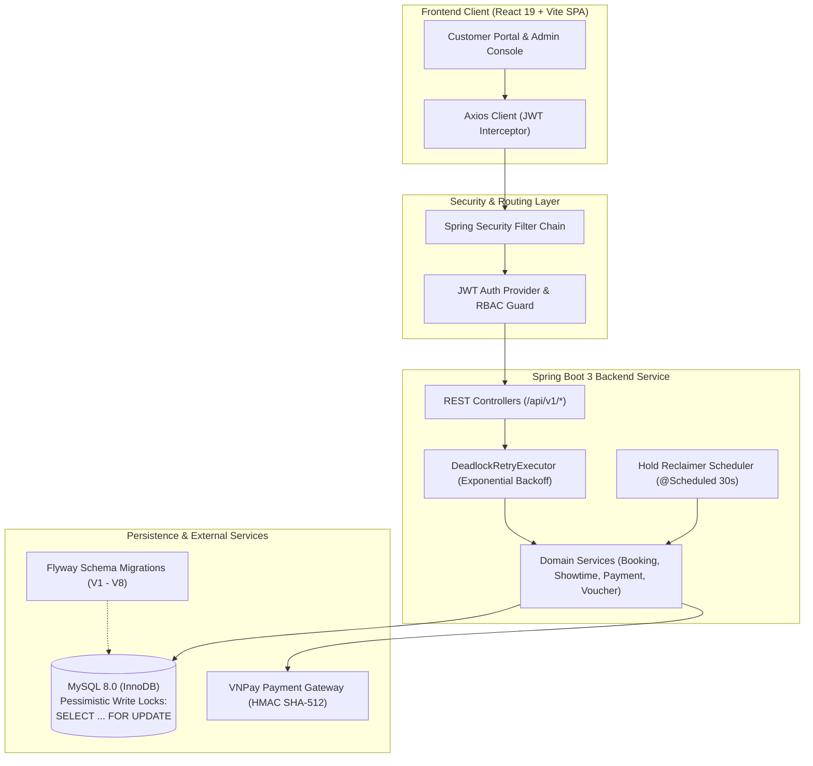

# 🎬 GoToro Cinema — High-Concurrency Movie Theater Booking Platform

[](https://github.com/KhanhVu052/movie-theater-booking-system/actions/workflows/ci.yml)
[](https://www.oracle.com/java/)
[](https://spring.io/projects/spring-boot)
[](https://www.mysql.com/)
[](https://react.dev/)
[](https://vitejs.dev/)
[](https://tailwindcss.com/)
[](https://vitest.dev/)

A portfolio project demonstrating high-concurrency ticket booking, strict transactional locking, and idempotent online payment settlement. Engineered with **Java 21**, **Spring Boot 3**, **MySQL 8.0**, and **React 19**. Built to handle high-concurrency seat reservation bursts with strict ACID financial transaction guarantees, deadlock-free pessimistic locking, dynamic pricing policies, and automated refund pipelines.

---

## 🏗️ System Architecture



---

## ⚡ Key Engineering Highlights

### 1. High-Concurrency Seat Reservation & Deadlock Prevention
* **Deterministic Lock Ordering**: Prevents database deadlocks during flash-sale booking spikes by acquiring row-level pessimistic write locks in a strict hierarchy:
  1. `users` row lock (`SELECT ... FOR UPDATE` to enforce active pending order ceilings)
  2. `showtimes` shared lock (`SELECT ... FOR SHARE`)
  3. `bookings` row lock (`ORDER BY id ASC`)
  4. `showtime_seats` row locks (`ORDER BY id ASC`)
  5. `vouchers` row lock (`SELECT ... FOR UPDATE`)
* **Deadlock Auto-Recovery**: Critical database transactions are wrapped in a `DeadlockRetryExecutor` implementing exponential backoff jitter on transient MySQL deadlock exceptions (`Error Code: 1213`).
* **10-Minute Hold Expiration**: When a user selects seats, inventory is held for exactly 10 minutes. An automated background sweeper (`@Scheduled` every 30 seconds) and on-demand transactional checks atomically release abandoned holds and restore voucher quotas.
* **Orphan Seat Detection Algorithm**: Validates that customer selections do not leave awkward single isolated empty seats in a row, maximizing theater occupancy efficiency.

### 2. Financial Integrity & Automated Refunds
* **Realized Revenue Auditing**: Revenue reporting strictly aggregates only confirmed `SUCCESS` payments where `refund_status = 'NONE'`, ensuring financial reporting reflects cash actually retained.
* **Showtime Cancellation Pipeline**: Canceling a showtime automatically cascades across all associated confirmed bookings, marks payments as `REFUND_REQUIRED`, restores customer voucher usage limits, and records audit logs.
* **Customer-Initiated Cancellation**: Customers can cancel tickets and request a 100% refund up to 60 minutes before showtime. Cancellations within the 60-minute cutoff are strictly rejected.

### 3. Promotional Voucher Engine with Per-User Quotas
* Supports percentage-based and fixed-amount discounts with configurable minimum order values and maximum discount caps.
* **Per-User Usage Tracking**: Backend calculates `userUsedCount` and `remainingUserQuota`. When a customer reaches their individual limit, the voucher is visually dimmed, locked, and prevented from applying.

### 4. Conflict-Free Auditorium Scheduling
* Enforces room collision detection ensuring no two screenings overlap in the same hall.
* Automatically schedules an enforced **15-minute cleaning buffer** (`cleaning_end_time = end_time + 15m`) after every movie duration.

---

## 📸 Screenshots

| Home & Movie Selection | Seat Matrix & Types | E-Ticket & Checkout |
|:---:|:---:|:---:|
|  |  |  |

---

## 🚀 Quick Start & Installation

> [!NOTE]
> The scripts `run-backend.bat` and `run-all-tests.bat` in the repository root are convenience utilities for Windows environments. macOS and Linux users can execute the equivalent `./mvnw` and `npm` commands directly as detailed below.

### Prerequisites
* **Java**: OpenJDK 21+
* **Node.js**: v20 or v22 LTS
* **Container Engine**: Docker & Docker Compose (for local database)
* **Build Tools**: Maven Wrapper (`./mvnw`), npm

---

### Step 1: Start MySQL Database
Launch the preconfigured MySQL 8.0 database container:
```bash
docker compose up -d
```
*Port:* `127.0.0.1:3306` | *Database:* `cinema_booking_db` | *User:* `root` | *Password:* `root`

> [!NOTE]
> The included `docker-compose.yml` configuration (with default credentials `root` / `root`) is strictly intended for local development convenience. Never deploy default credentials or unhardened root access to staging or production environments.

*(Optional: If using your own local MySQL server, execute:)*
```sql
CREATE DATABASE cinema_booking_db CHARACTER SET utf8mb4 COLLATE utf8mb4_unicode_ci;
```

---

### Step 2: Configure Environment Variables
Copy the sample environment template and generate a cryptographically secure JWT secret:

**Linux / macOS:**
```bash
cp .env.example .env
# Generate 48-byte Base64 key and update JWT_SECRET in .env
openssl rand -base64 48
```

**Windows (PowerShell):**
```powershell
Copy-Item .env.example .env
# Generate Base64 key:
[Convert]::ToBase64String((1..48 | ForEach-Object { Get-Random -Minimum 0 -Maximum 256 }))
```

Ensure `.env` contains:
```env
DB_URL=jdbc:mysql://localhost:3306/cinema_booking_db?useSSL=false&serverTimezone=Asia/Ho_Chi_Minh&allowPublicKeyRetrieval=true&characterEncoding=UTF-8
DB_USERNAME=root
DB_PASSWORD=root
JWT_SECRET=<YOUR_GENERATED_BASE64_KEY>
BOOTSTRAP_ADMIN_EMAIL=admin@cinema.com
BOOTSTRAP_ADMIN_PASSWORD=<YOUR_ADMIN_PASSWORD>
DEV_TOOLS_ENABLED=true
```

---

### Step 3: Run Backend Service

**Linux / macOS:**
```bash
set -a; source .env; set +a
cd backend
./mvnw spring-boot:run
```

**Windows:**
```cmd
run-backend.bat
```
*(Alternatively on Windows PowerShell: `cd backend; .\mvnw.cmd spring-boot:run`)*

*API Base URL:* **`http://localhost:8080`**  
Flyway will automatically execute migrations `V1` through `V8` on first boot.

---

### Step 4: Run Frontend Application

```bash
cd frontend
npm install
npm run dev
```
*Web Client URL:* **`http://localhost:5173`**

---

## 🔑 Default Credentials

| Role | Email | Password | Permissions |
|:---|:---|:---|:---|
| **System Administrator** | Configured via `BOOTSTRAP_ADMIN_EMAIL` in `.env` | Configured via `BOOTSTRAP_ADMIN_PASSWORD` in `.env` | Full access to `/admin`: scheduling, catalog, vouchers, revenue reports, refunds |
| **Demo Customer** | Self-register via `/register` | *(User chosen)* | Browse movies, select seats, apply vouchers, hold & checkout, review |

> **Security & Admin Credentials Note:** The system initializes the administrator account from your `.env` variables (`BOOTSTRAP_ADMIN_EMAIL` and `BOOTSTRAP_ADMIN_PASSWORD`) on first startup. Check your `.env` file for the exact credentials configured for your local environment.

> **Local Sandbox Demo Note:** When `DEV_TOOLS_ENABLED=true`, the checkout page features an instant payment simulation option that verifies all hold validity rules without requiring external VNPay merchant network callbacks.

---

## 🧪 Testing & CI/CD Pipeline

The project is backed by comprehensive automated test suites enforcing business rules, database integrity, and code quality.

### Automated Testing Commands

```bash
# 1. Run Frontend Unit Tests (69 Vitest specifications)
cd frontend
npm test

# 2. Run Frontend Lint (ESLint)
cd frontend
npm run lint

# 3. Compile & Run Backend Tests (Maven)
cd backend
./mvnw test
```
*(On Windows, you can also run `run-all-tests.bat` to execute both test suites in sequence.)*

### GitHub Actions CI Workflow (`.github/workflows/ci.yml`)
Every push and pull request to `main` triggers isolated multi-job continuous integration:
* **Frontend CI Job**:
  * Environment: `ubuntu-latest` with Node.js 22.
  * Verifies dependency tree (`npm ci`), code formatting & standards (`npm run lint`), business rule tests (`npm test`), and production asset bundling (`npm run build`).
* **Backend CI Job**:
  * Environment: `ubuntu-latest` with Eclipse Temurin JDK 21.
  * Executes `./mvnw -B verify` running automated unit tests and integration tests with **Testcontainers** (spinning up ephemeral MySQL Docker containers to validate Flyway schema migrations, pessimistic locking queries, and JPA persistence rules).

---

## 📖 Documentation Index

* **[Software Requirements Specification (SRS)](./docs/SRS.md)**: Full functional requirements, pricing policy formulas, and domain rules.
* **[E2E Acceptance Test Manual (QA_TEST_SCENARIOS.md)](./docs/QA_TEST_SCENARIOS.md)**: Comprehensive click-by-click manual testing handbook.
* **[Release Changelog](./docs/CHANGELOG.md)**: Historical release notes and sprint improvements.
* **[Documentation Hub](./docs/README.md)**: Central directory for all architectural specifications.

---

## 📄 License
This project is licensed under the MIT License - see the [LICENSE](LICENSE) file for details.
